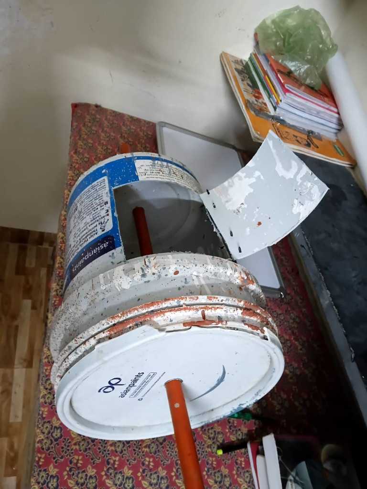
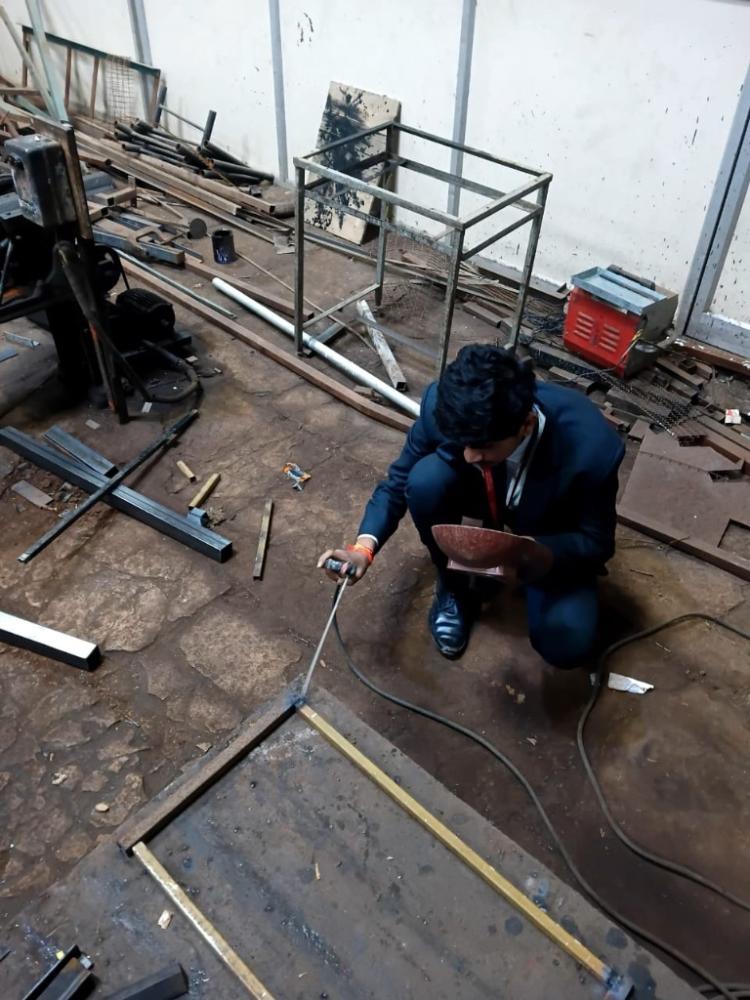

# Smart Composting System

**Mechanical Design | Physical Model | Sustainable Engineering**

A student mechanical engineering project focused on developing a physical composting system using a 20-litre bucket and a mechanical mixing arrangement. The project demonstrates practical mechanical design, fabrication, assembly and sustainable waste-management concepts.

> **Project status:** The supplied SolidWorks assembly and part files are included as the current CAD reference. They do not confirm that the physical model is complete or matches the CAD. Photographs document frame fabrication and bucket/shaft assembly in progress. Dimensions, materials, detailed operating method and composting performance are to be confirmed.

[Open the project website](https://mayurdarekar2228-alt.github.io/Smart-Composting-System/) · [View the CAD gallery](#10-cad-design-gallery)

---

## 1. Project Introduction

Organic waste can be a useful resource when it is managed and processed appropriately. This project explores the mechanical design and construction of a physical composting system. Its scope is the container, mixing arrangement, fabrication and assembly—not measured composting performance.

## 2. Project Overview

| Item | Project information |
|---|---|
| Project | Smart Composting System |
| Discipline | Mechanical Engineering |
| Model | Physical composting-system concept |
| Bucket capacity | 20 litres, as specified by the project team |
| Mixing | Mechanical mixing arrangement; operating details to be confirmed |
| Current evidence | Supplied SolidWorks assembly and component files; photographs of frame fabrication and bucket/shaft assembly in progress |
| Dimensions, materials and test results | To be confirmed |

The project name is retained from the team brief; capabilities beyond the documented mechanical scope are not assumed.

## 3. Problem Statement

Small compost batches need to be handled in a way that supports practical mixing and access to the material. The project addresses this mechanical-design challenge by developing a bucket-based physical model and a mixing arrangement. The geometry, assembly details and effectiveness need to be confirmed through drawings and documented testing.

## 4. Project Objectives

- Develop a physical composting-system concept around a 20-litre bucket.
- Design a mechanical arrangement for mixing the contents.
- Apply mechanical-design principles to component layout and assembly.
- Document fabrication work and distinguish work in progress from completed construction.
- Identify the checks and testing needed before making performance claims.

## 5. Project Team

| Member | Name | PRN |
|---|---|---|
| 1 | Mayur Santosh Darekar | 2126UMEM1024 |
| 2 | Sairaj Hon | 2126UMEM1012 |
| 3 | Abhinav Bothe | PRN not provided |
| 4 | Pratik Bankar | 2126UMEM1022 |

## 6. Physical Model Description

The project brief specifies a physical model using a 20-litre bucket and a mechanical mixing arrangement. The supplied CAD assembly depicts a 20-litre drum or pail supported by a frame, with crank and rotor-hub components. These files document a CAD design; they do not establish that the final model is complete or that it matches the physical build. Supplied photographs document frame fabrication and bucket/shaft assembly in progress.

The mixing arrangement, mounting, bucket interfaces, operating method and final construction details are **to be confirmed** against the approved design and completed model.

## 7. Mechanical Components

| Component or feature | Project role | Status |
|---|---|---|
| 20-litre drum / pail | Main container in the supplied CAD assembly | Capacity stated in the project brief and part filename; material and usable volume to be confirmed |
| Stand A-frame and longitudinal braces | CAD support-structure components | Included in the assembly; physical dimensions, material and completion status to be confirmed |
| Bearing blocks and plain bushes | CAD components at the drum support interfaces | Included in the assembly; fit, material and operating loads to be confirmed |
| Rotor hub / stubs, crank arm and grip | CAD components associated with the drum's turning arrangement | Included in the assembly; detailed drive path and operating method to be confirmed |
| Pail end lid and folding lid | CAD closure/access components | Included in the assembly; configuration and secure closure to be confirmed |

No unverified dimensions, materials, loads or component ratings are assumed in this document.

## 8. Working Principle

Organic material is intended to be placed in the bucket. The supplied CAD assembly includes a crank arm, crank grip and rotor-hub components, but the exact relationship between these parts and the mixing function, loading procedure, turning schedule and safe working capacity are to be confirmed.

Mixing alone does not establish compost maturity. Feedstock, moisture, aeration, temperature and time affect the process; no performance result is claimed.

## 9. Mechanical Design and Construction

The supplied SolidWorks assembly and part files in [`assets/cad/`](assets/cad/) are the current CAD reference. They show a 20-litre drum or pail, frame/support components, bearing and bush components, crank/rotor components, and lid components. Their dimensions, materials and fit have not been independently verified against the physical model.

Before construction or operation, confirm the approved drawings, component fits, frame stability, moving clearances, fasteners, access closure and safe operating procedure. Record any changes made during fabrication.

## 10. CAD Design Gallery

The links below are the supplied native SolidWorks files, not rendered images or photographs. They document the CAD design but do not prove that the physical model is complete or matches the assembly. Keep the assembly and its referenced part files together when opening the assembly.

### Overall Assembly

[Composter_Assembly.SLDASM — download the native assembly](assets/cad/Composter_Assembly.SLDASM)

### Bucket Design

- [Drum_Pail_20L.SLDPRT](assets/cad/Drum_Pail_20L.SLDPRT)
- [Pail_End_Lid.SLDPRT](assets/cad/Pail_End_Lid.SLDPRT)
- [Folding_Lid.SLDPRT](assets/cad/Folding_Lid.SLDPRT)

### Crank and Rotor Components

- [Rotor_Hub_Stub.SLDPRT](assets/cad/Rotor_Hub_Stub.SLDPRT)
- [Crank_Arm.SLDPRT](assets/cad/Crank_Arm.SLDPRT)
- [Crank_Grip.SLDPRT](assets/cad/Crank_Grip.SLDPRT)

### Frame and Support Components

- [Stand_A_Frame.SLDPRT](assets/cad/Stand_A_Frame.SLDPRT)
- [Longitudinal_Brace.SLDPRT](assets/cad/Longitudinal_Brace.SLDPRT)
- [Bearing_Block.SLDPRT](assets/cad/Bearing_Block.SLDPRT)
- [Plain_Bush.SLDPRT](assets/cad/Plain_Bush.SLDPRT)

### Additional Supplied Parts

The relationship of these standalone files to the supplied assembly has not been confirmed:

- [composter.SLDPRT](assets/cad/composter.SLDPRT)
- [composter 2.SLDPRT](assets/cad/composter%202.SLDPRT)

### Physical Model — Work in Progress

No photograph of the completed composting system has been supplied. The following photographs document work in progress:

## 11. Manufacturing and Assembly

The supplied photographs document metal-frame fabrication and bucket/shaft assembly in progress. They do not show or confirm completion of the full composting system.

A project-specific manufacturing and assembly record should identify the approved drawings, actual materials, fabrication steps, joining methods, component fit checks and inspection results. Details not documented in the repository are to be confirmed by the team.

## 12. Applications

Potential applications include mechanical-engineering education, demonstration of sustainable-waste concepts and small-scale composting trials. Suitability for any particular feedstock, setting or operating scale has not been validated.

## 13. Advantages

- Provides a physical context for learning mechanical design and assembly.
- Combines a container with a mechanical mixing concept.
- Offers opportunities to document fabrication and evaluate design decisions.
- Encourages practical exploration of sustainable waste-management concepts.

These are educational and design benefits, not measured performance claims.

## 14. Limitations

- Final dimensions, construction materials and usable capacity are to be confirmed.
- Detailed mixing geometry, mounting and operating method are to be confirmed.
- Older CAD illustrations retained in `assets/images/` are not verified against the supplied assembly and are not used in the active gallery.
- The supplied photographs show fabrication and assembly in progress, not the completed model.
- No composting-time, product-quality, capacity-under-load or performance test results are provided.

## 15. Future Improvements

- Verify the supplied CAD assembly against the completed physical 20-litre model.
- Record dimensions, materials, component interfaces and assembly sequence.
- Complete and photograph the physical model, with captions that reflect its actual status.
- Review stability, clearances, closure and safe operation before use.
- Conduct documented trials with recorded batch inputs, operating conditions and observations.
- Update this repository when verified design or test information becomes available.

## 16. Conclusion

The Smart Composting System is a mechanical-engineering project centered on a physical 20-litre bucket model and a mechanical mixing arrangement. The repository now distinguishes CAD concepts from workshop evidence and work in progress. Final construction details and composting performance remain to be verified.

## 17. Acknowledgements

The project team acknowledges the contributors who prepared the SolidWorks files and shared the workshop photographs. Additional acknowledgements are to be confirmed by the team.

---

The original presentation files in [`docs/`](docs/) are retained for reference. Review them against the corrected project scope before treating their technical content as current.
