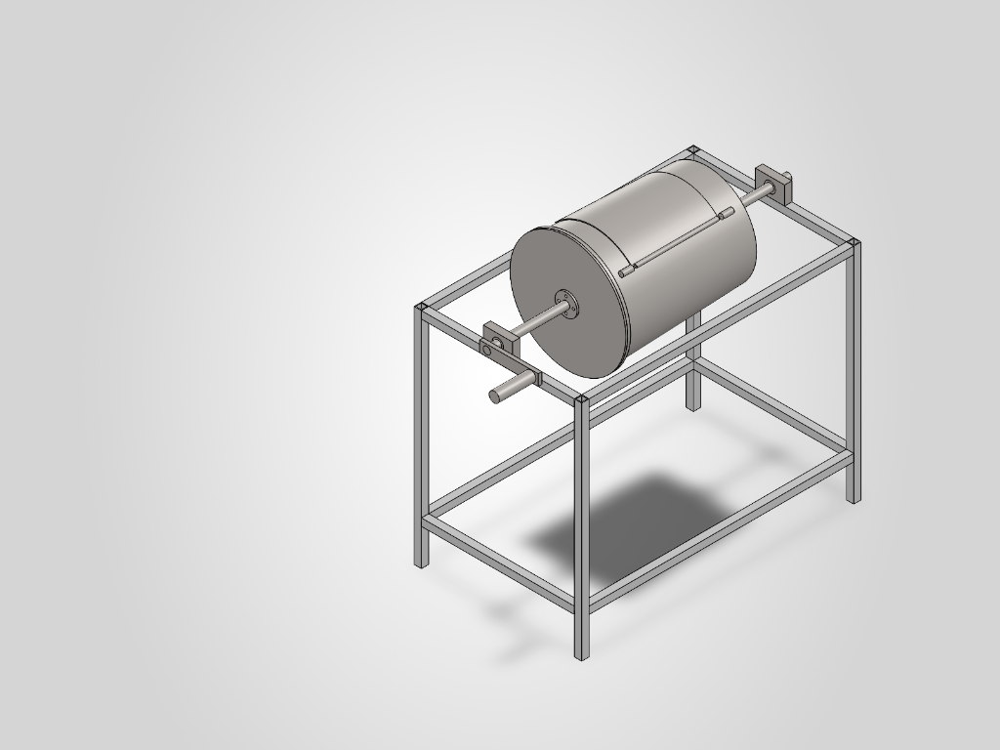
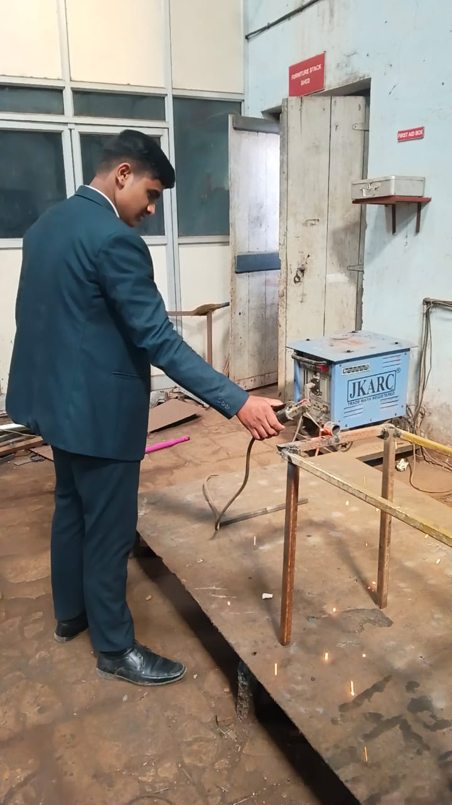
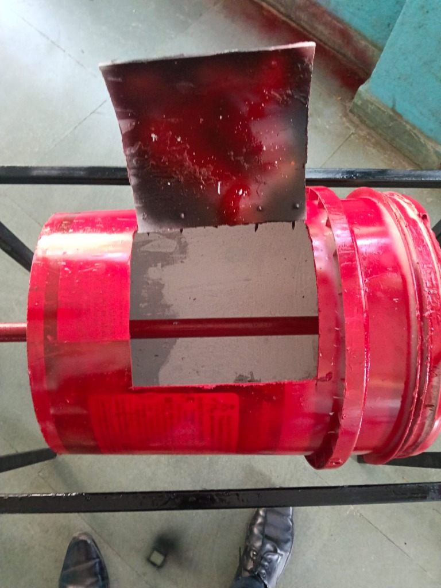
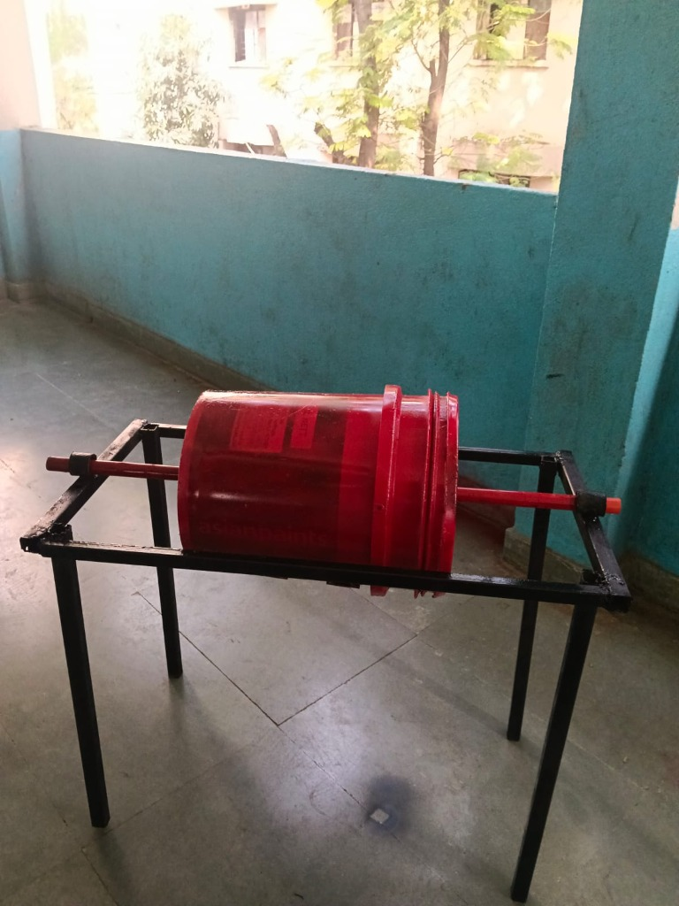

# Smart Composting System

**Mechanical Design | Physical Model | Sustainable Engineering**

A student mechanical engineering project focused on developing a physical composting system using a 20-litre bucket and a mechanical mixing arrangement. The project demonstrates practical mechanical design, fabrication, assembly and sustainable waste-management concepts.

> **Project status:** The repository contains supplied SolidWorks files and team photos of frame welding and the red-drum physical model. Correspondence between the CAD and photographed model has not been verified. Dimensions, materials, operating method and composting performance remain to be confirmed.

[Open the project website](https://mayurdarekar2228-alt.github.io/Smart-Composting-System/) · [View the CAD gallery](#10-cad-design-gallery)

---

## Makerspace Learning

Laser cutting and FDM 3D printing are independent makerspace learning activities, separate from the Smart Composting System project. Neither method was used to make the composting project. The repository includes four laser-cutting practice photos; no 3D-printing photos have been supplied yet. The learning notes cover CO2 laser workflow and safety, the Bambu Studio process, and the Bambu Lab A1 mini, H2D, X1, and P1 model families: [Makerspace Learning](Documentation/Makerspace-Learning.md).

The A1 mini and H2D specifications in the learning guide link to current Bambu Lab technical pages. Confirm the exact printer configuration before adding personal hands-on claims or machine-specific settings.

## 1. Project Introduction

Organic waste can be a useful resource when it is managed and processed appropriately. This project explores the mechanical design and construction of a physical composting system. Its scope is the container, mixing arrangement, fabrication and assembly—not measured composting performance.

## 2. Project Overview

| Item | Project information |
|---|---|
| Project | Smart Composting System |
| Discipline | Mechanical Engineering |
| Model | Physical composting-system concept |
| Bucket capacity | 20 litres, as specified by the project team |
| Mixing | Mechanical mixing arrangement; operating details to be confirmed |
| Current evidence | Supplied SolidWorks files; team photos of frame welding, drum detail and the model on its support frame |
| Dimensions, materials and test results | To be confirmed |

The project name is retained from the team brief; capabilities beyond the documented mechanical scope are not assumed.

## 3. Problem Statement

Small compost batches need to be handled in a way that supports practical mixing and access to the material. The project addresses this mechanical-design challenge by developing a bucket-based physical model and a mixing arrangement. The geometry, assembly details and effectiveness need to be confirmed through drawings and documented testing.

## 4. Project Objectives

- Develop a physical composting-system concept around a 20-litre bucket.
- Design a mechanical arrangement for mixing the contents.
- Apply mechanical-design principles to component layout and assembly.
- Document fabrication work and distinguish work in progress from completed construction.
- Identify the checks and testing needed before making performance claims.

## 5. Project Team

| Member | Name | PRN |
|---|---|---|
| 1 | Mayur Santosh Darekar | 2126UMEM1024 |
| 2 | Sairaj Hon | 2126UMEM1012 |
| 3 | Abhinav Bothe | 2126UMEM1086 |
| 4 | Pratik Bankar | 2126UMEM1022 |

## 6. Physical Model Description

The project brief specifies a physical composting model. Team-supplied photos show a red cylindrical drum with a central axle on a welded support frame, along with frame-welding work. The supplied SolidWorks files describe a CAD design, but their correspondence with the photographed physical model has not been verified.

The mixing arrangement, mounting, bucket interfaces, operating method and final construction details are **to be confirmed** against the approved design and completed model.

## 7. Mechanical Components

| Component or feature | Project role | Status |
|---|---|---|
| 20-litre drum / pail | Main container in the supplied CAD assembly | Capacity stated in the project brief and part filename; material and usable volume to be confirmed |
| Stand A-frame and longitudinal braces | CAD support-structure components | Included in the assembly; physical dimensions, material and completion status to be confirmed |
| Bearing blocks and plain bushes | CAD components at the drum support interfaces | Included in the assembly; fit, material and operating loads to be confirmed |
| Rotor hub / stubs, crank arm and grip | CAD components associated with the drum's turning arrangement | Included in the assembly; detailed drive path and operating method to be confirmed |
| Pail end lid and folding lid | CAD closure/access components | Included in the assembly; configuration and secure closure to be confirmed |

No unverified dimensions, materials, loads or component ratings are assumed in this document.

## 8. Working Principle

Organic material is intended to be placed in the bucket. The supplied CAD assembly includes a crank arm, crank grip and rotor-hub components, but the exact relationship between these parts and the mixing function, loading procedure, turning schedule and safe working capacity are to be confirmed.

Mixing alone does not establish compost maturity. Feedstock, moisture, aeration, temperature and time affect the process; no performance result is claimed.

## 9. Mechanical Design and Construction

The supplied SolidWorks assembly and part files in [`assets/cad/`](assets/cad/) are the current CAD reference. They show a 20-litre drum or pail, frame/support components, bearing and bush components, crank/rotor components, and lid components. Their dimensions, materials and fit have not been independently verified against the physical model.

Before construction or operation, confirm the approved drawings, component fits, frame stability, moving clearances, fasteners, access closure and safe operating procedure. Record any changes made during fabrication.

### Project Dimensions: CAD, Fabrication, and Final Assembly

The project brief specifies a **20-litre drum capacity**; this is not a linear dimension. A verified dimensioned drawing and as-built measurement record are not currently documented, so linear values are marked **to be confirmed** rather than estimated.

| Stage | Dimensions and records to complete |
|---|---|
| **1. 3D modelling** | Drum length/diameter/wall thickness; frame overall length/width/height and member sections; shaft and bearing spacing; crank radius and swept clearance; lid opening; component fits and clearances. |
| **2. Fabrication** | Frame cut lengths and sections; member angles; hole and joint positions; material specifications; frame diagonals/squareness; actual as-fabricated measurements and deviations. |
| **3. Final assembly** | Assembled envelope and footprint; drum-axis height and bearing alignment; drum-to-frame and crank clearances; lid movement/retention; as-built comparison with CAD. |

Use the [project dimension register](Documentation/Project-Dimensions.md) to record verified values, units, source drawings, and inspection results.

## 10. CAD Design Gallery

The links below are the latest native SolidWorks files supplied for the straight-stand-and-bucket assembly, not rendered images or photographs. Their match to the team-supplied physical model photos has not been verified. Keep the assembly and its referenced part files together when opening the assembly.

The website's front page and gallery use the supplied straight-stand-and-bucket SolidWorks render as a design reference; it is labeled as unverified and is not presented as a confirmed match to the physical model.

The website currently provides CAD downloads rather than an interactive browser-based 3D viewer. A rotating preview can be added when the team supplies a web-ready model export and verifies that it matches the intended design.

### Stand and Bucket Assembly Preview

The website gallery includes a team-supplied SolidWorks render of the straight stand with the bucket assembly. Its match to the photographed physical model has not been verified.

### Overall Assembly

[Composter_Assembly.SLDASM — download the native assembly](assets/cad/Composter_Assembly.SLDASM)

### Bucket Design

- [Drum_Pail_20L.SLDPRT](assets/cad/Drum_Pail_20L.SLDPRT)
- [Pail_End_Lid.SLDPRT](assets/cad/Pail_End_Lid.SLDPRT)
- [Folding_Lid.SLDPRT](assets/cad/Folding_Lid.SLDPRT)

### Crank and Rotor Components

- [Rotor_Hub_Stub.SLDPRT](assets/cad/Rotor_Hub_Stub.SLDPRT)
- [Crank_Arm.SLDPRT](assets/cad/Crank_Arm.SLDPRT)
- [Crank_Grip.SLDPRT](assets/cad/Crank_Grip.SLDPRT)

### Frame and Support Components

- [Saved_Straight_Stand.SLDPRT](assets/cad/Saved_Straight_Stand.SLDPRT)
- [Bearing_Crossrail.SLDPRT](assets/cad/Bearing_Crossrail.SLDPRT)
- [Bearing_Block.SLDPRT](assets/cad/Bearing_Block.SLDPRT)
- [Plain_Bush.SLDPRT](assets/cad/Plain_Bush.SLDPRT)

### Team-Supplied Physical Model Photos

These photos document welding work and the physical model. They do not establish safe operation, composting performance or a match with the supplied CAD files.

## 11. Manufacturing and Assembly

The supplied photographs show frame-welding work, a drum detail and the model on its support frame. They are visual documentation only and do not verify CAD correspondence, operating safety or composting performance.

Follow the documented sequence: complete the dimensioned 3D model and release drawings; fabricate from verified cut lists and material specifications; assemble the supports, drum, rotational components and lid; then measure and inspect the completed assembly. Record as-built dimensions and any deviations from CAD. Linear dimensions, material specifications, and inspection results remain to be confirmed in the [project dimension register](Documentation/Project-Dimensions.md) and [manufacturing process](Documentation/Manufacturing-Process.md).

## 12. Applications

Potential applications include mechanical-engineering education, demonstration of sustainable-waste concepts and small-scale composting trials. Suitability for any particular feedstock, setting or operating scale has not been validated.

The garden connection is a proposed educational use: explore whether suitable organic waste can be processed and, after appropriate maturation and checks, considered for garden use. No finished compost, soil benefit or gardening result is claimed.

## 13. Advantages

- Provides a physical context for learning mechanical design and assembly.
- Combines a container with a mechanical mixing concept.
- Offers opportunities to document fabrication and evaluate design decisions.
- Encourages practical exploration of sustainable waste-management concepts.

These are educational and design benefits, not measured performance claims.

## 14. Limitations

- Final dimensions, construction materials and usable capacity are to be confirmed.
- Detailed mixing geometry, mounting and operating method are to be confirmed.
- The isometric CAD render is not verified against the supplied assembly or physical model and is labeled as a reference only.
- The photographs do not establish safe operation, composting performance or correspondence between the physical model and supplied CAD.
- No composting-time, product-quality, capacity-under-load or performance test results are provided.

## 15. Future Improvements

- Verify the supplied CAD assembly against the photographed physical model.
- Record dimensions, materials, component interfaces and assembly sequence.
- Document any remaining assembly work and verify the physical model against the intended design.
- Add an interactive browser preview after verifying a web-ready model export against the intended design.
- Review stability, clearances, closure and safe operation before use.
- Conduct documented trials with recorded batch inputs, operating conditions and observations.
- Update this repository when verified design or test information becomes available.

## 16. Conclusion

The Smart Composting System is a mechanical-engineering project centered on a physical composting model and a mechanical mixing arrangement. Team-supplied photos show the red-drum model and welding work; its design details, CAD correspondence, operating safety and composting performance remain to be verified.

## 17. Acknowledgements

The project team acknowledges the contributors who prepared the SolidWorks files and shared the workshop photographs. Additional acknowledgements are to be confirmed by the team.

---

The original presentation files in [`docs/`](docs/) are retained for reference. Review them against the corrected project scope before treating their technical content as current.
