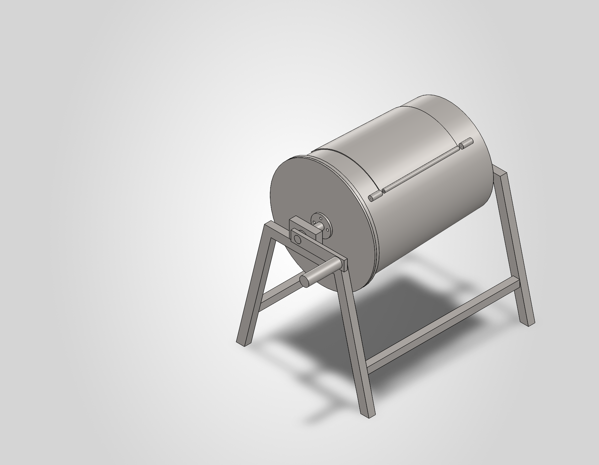
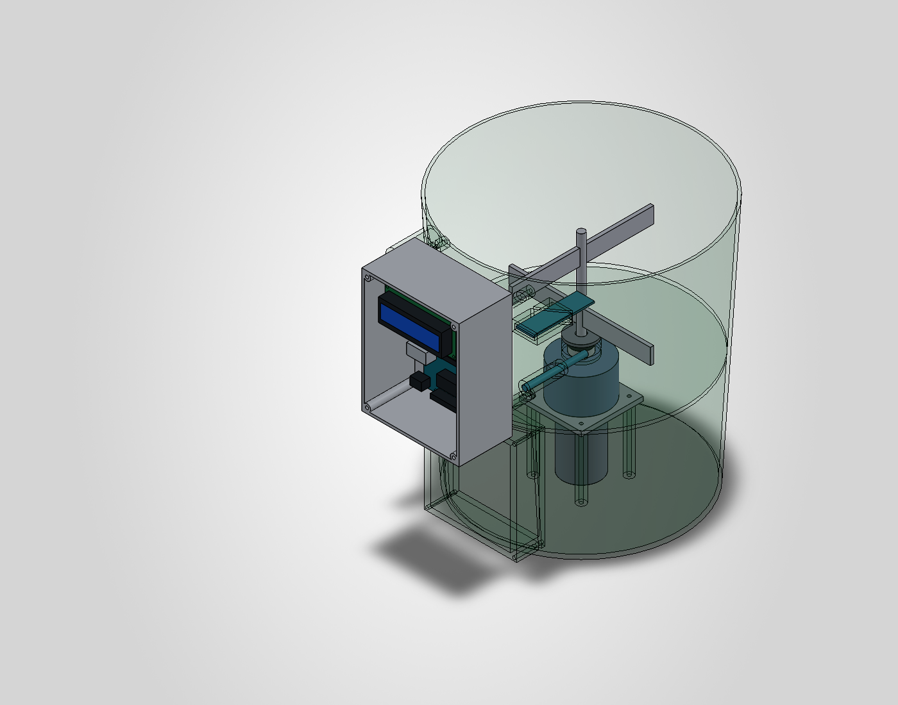
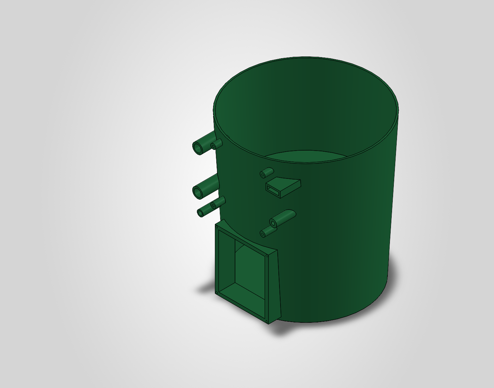
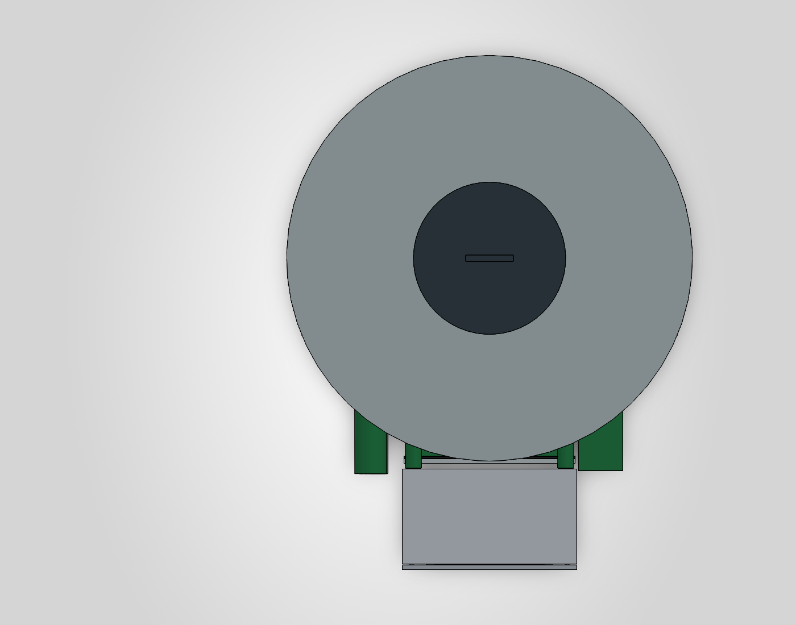
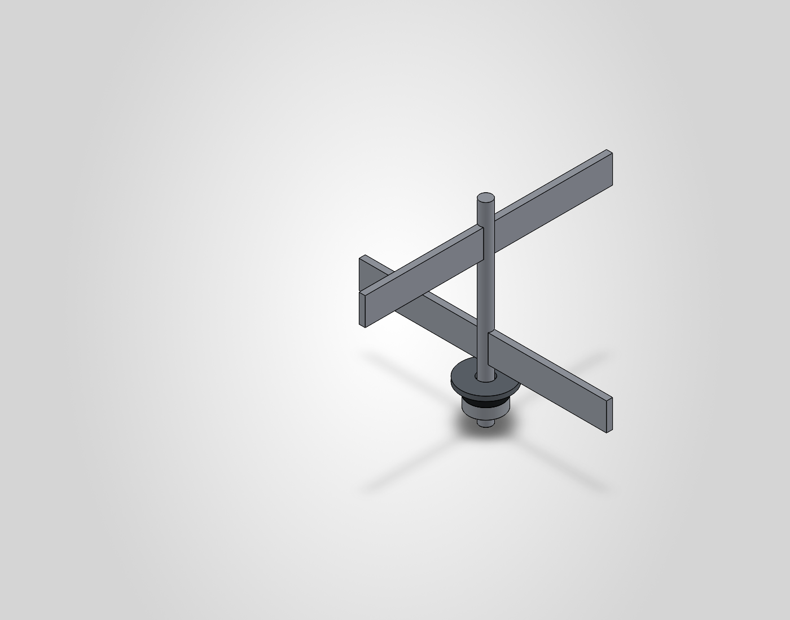
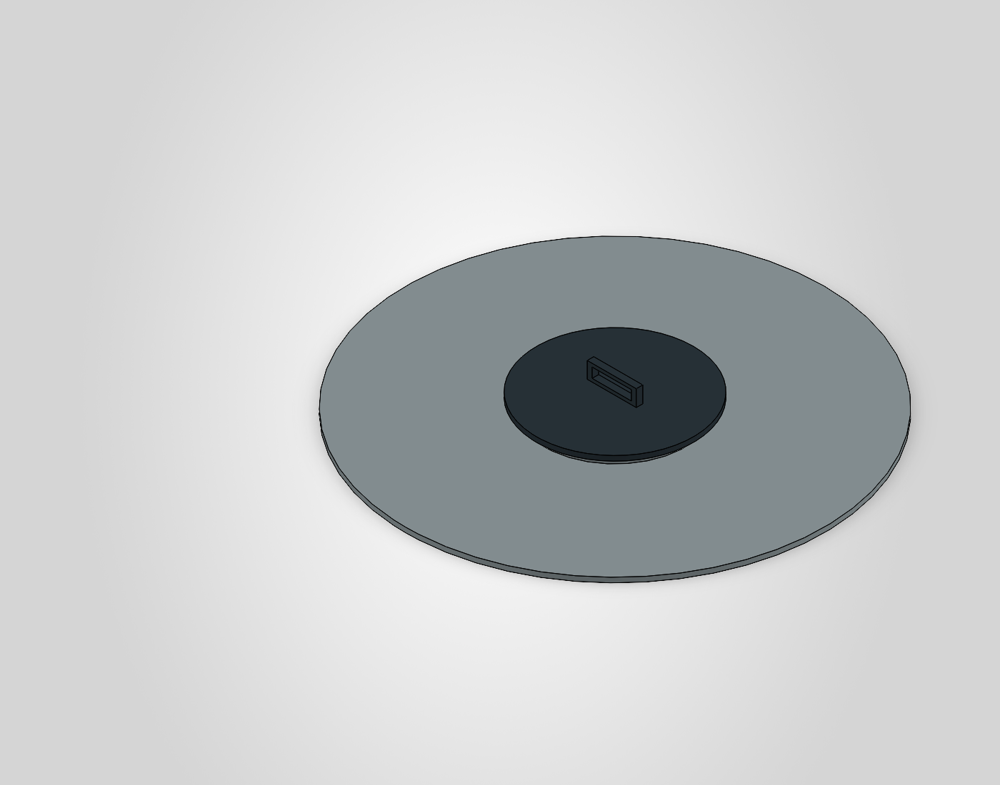
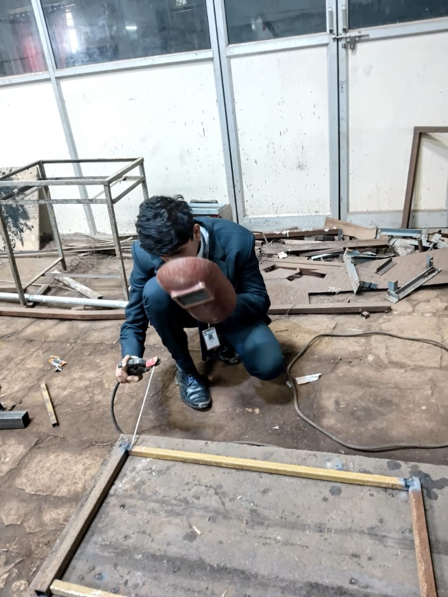

# Smart Composting System

**Mechanical Design | Physical Model | Sustainable Engineering**

A student mechanical engineering project focused on developing a physical composting system using a 20-litre bucket and a mechanical mixing arrangement. The project demonstrates practical mechanical design, fabrication, assembly and sustainable waste-management concepts.

> **Project status:** The supplied workshop photographs show frame fabrication in progress. CAD illustrations are reference material only; they are not verified as the final 20-litre model. Dimensions, materials, detailed component configuration and composting performance are to be confirmed.

[Open the project website](https://mayurdarekar2228-alt.github.io/Smart-Composting-System/) · [View the CAD gallery](#10-cad-design-gallery)

---

## 1. Project Introduction

Organic waste can be a useful resource when it is managed and processed appropriately. This project explores the mechanical design and construction of a physical composting system. Its scope is the container, mixing arrangement, fabrication and assembly—not measured composting performance.

## 2. Project Overview

| Item | Project information |
|---|---|
| Project | Smart Composting System |
| Discipline | Mechanical Engineering |
| Model | Physical composting-system concept |
| Bucket capacity | 20 litres, as specified by the project team |
| Mixing | Mechanical mixing arrangement; operating details to be confirmed |
| Current evidence | CAD illustrations and workshop photographs of frame fabrication in progress |
| Dimensions, materials and test results | To be confirmed |

The project name is retained from the team brief; capabilities beyond the documented mechanical scope are not assumed.

## 3. Problem Statement

Small compost batches need to be handled in a way that supports practical mixing and access to the material. The project addresses this mechanical-design challenge by developing a bucket-based physical model and a mixing arrangement. The geometry, assembly details and effectiveness need to be confirmed through drawings and documented testing.

## 4. Project Objectives

- Develop a physical composting-system concept around a 20-litre bucket.
- Design a mechanical arrangement for mixing the contents.
- Apply mechanical-design principles to component layout and assembly.
- Document fabrication work and distinguish work in progress from completed construction.
- Identify the checks and testing needed before making performance claims.

## 5. Project Team

| Member | Name | PRN |
|---|---|---|
| 1 | Mayur Santosh Darekar | 2126UMEM1024 |
| 2 | Sairaj Hon | 2126UMEM1012 |
| 3 | Abhinav Bothe | PRN not provided |
| 4 | Pratik Bankar | 2126UMEM1022 |

## 6. Physical Model Description

The project brief specifies a physical model using a 20-litre bucket and a mechanical mixing arrangement. The supplied images include CAD illustrations and photographs of metal-frame fabrication in progress. They do not establish that the final model is complete or that the illustrated assemblies match the current build.

The mixing arrangement, mounting, bucket interfaces, operating method and final construction details are **to be confirmed** against the approved design and completed model.

## 7. Mechanical Components

| Component or feature | Project role | Status |
|---|---|---|
| 20-litre bucket | Main container for the composting model | Capacity stated in the project brief; usable volume and material to be confirmed |
| Mechanical mixing arrangement | Intended to mix or redistribute the contents | Detailed geometry, interfaces and operating method to be confirmed |
| Frame / support structure | Supports the physical assembly | Workshop photographs show frame fabrication in progress; dimensions and material to be confirmed |
| Lid and access features | Provide access to the container | Configuration and secure closure to be confirmed |

No unverified dimensions, materials, loads or component ratings are assumed in this document.

## 8. Working Principle

Organic material is placed in the bucket. The mechanical mixing arrangement is intended to redistribute the contents when operated. The exact loading procedure, actuation method, turning schedule and safe working capacity have not been documented and are to be confirmed.

Mixing alone does not establish compost maturity. Feedstock, moisture, aeration, temperature and time affect the process; no performance result is claimed.

## 9. Mechanical Design and Construction

The design work concerns the bucket, mixing arrangement, frame/support and interfaces between components. The repository includes earlier CAD illustrations; their dimensions and configuration have not been verified against the corrected 20-litre physical model.

Before construction or operation, confirm the approved drawings, component fits, frame stability, moving clearances, fasteners, access closure and safe operating procedure. Record any changes made during fabrication.

## 10. CAD Design Gallery

The following images are CAD illustrations supplied with the project. They are **not photographs** and do not prove that the depicted details are present in the final physical model. Their relationship to the current 20-litre design is to be confirmed.

### Overall Assembly

### Bucket Design

### Shaft and Paddle Mechanism

### Mechanical Components

### Final Physical Model

No photograph of the completed final model has been supplied. These workshop photographs show **frame fabrication in progress only**:

## 11. Manufacturing and Assembly

The supplied workshop photographs document metal-frame fabrication in progress. They do not show or confirm completion of the full composting system.

A project-specific manufacturing and assembly record should identify the approved drawings, actual materials, fabrication steps, joining methods, component fit checks and inspection results. Details not documented in the repository are to be confirmed by the team.

## 12. Applications

Potential applications include mechanical-engineering education, demonstration of sustainable-waste concepts and small-scale composting trials. Suitability for any particular feedstock, setting or operating scale has not been validated.

## 13. Advantages

- Provides a physical context for learning mechanical design and assembly.
- Combines a container with a mechanical mixing concept.
- Offers opportunities to document fabrication and evaluate design decisions.
- Encourages practical exploration of sustainable waste-management concepts.

These are educational and design benefits, not measured performance claims.

## 14. Limitations

- Final dimensions, construction materials and usable capacity are to be confirmed.
- Detailed mixing geometry, mounting and operating method are to be confirmed.
- The CAD illustrations are not verified as the final 20-litre design.
- The supplied photographs show fabrication in progress, not the completed model.
- No composting-time, product-quality, capacity-under-load or performance test results are provided.

## 15. Future Improvements

- Verify and update the CAD assembly for the physical 20-litre model.
- Record dimensions, materials, component interfaces and assembly sequence.
- Complete and photograph the physical model, with captions that reflect its actual status.
- Review stability, clearances, closure and safe operation before use.
- Conduct documented trials with recorded batch inputs, operating conditions and observations.
- Update this repository when verified design or test information becomes available.

## 16. Conclusion

The Smart Composting System is a mechanical-engineering project centered on a physical 20-litre bucket model and a mechanical mixing arrangement. The repository now distinguishes CAD concepts from workshop evidence and work in progress. Final construction details and composting performance remain to be verified.

## 17. Acknowledgements

The project team acknowledges the contributors who prepared the project material and shared the CAD illustrations and workshop photographs. Additional acknowledgements are to be confirmed by the team.

---

The original presentation files in [`docs/`](docs/) are retained for reference. Review them against the corrected project scope before treating their technical content as current.
